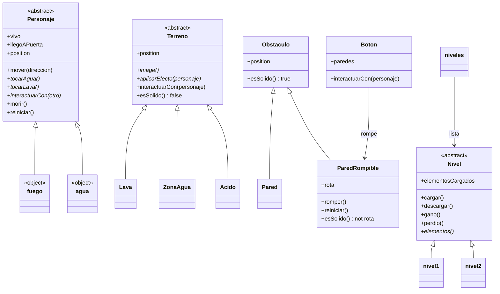
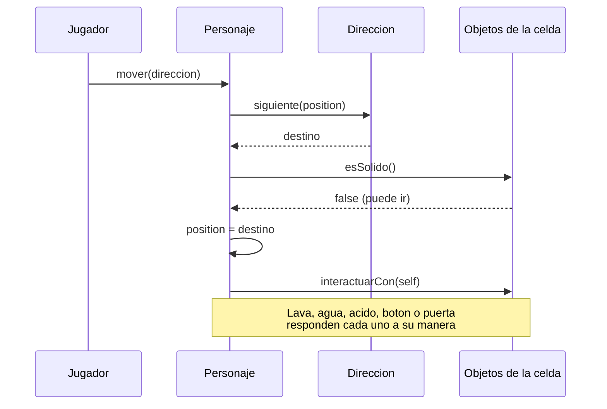

# Explicaciones teóricas

## Objetos y clases

Cada elemento del juego es un objeto con su responsabilidad: los personajes (`fuego`, `agua`), los terrenos (`Lava`, `ZonaAgua`, `Acido`), los obstáculos (`Pared`, `ParedRompible`), el `Boton`, las puertas (`PuertaFuego`, `PuertaAgua`), los niveles (`nivel1`, `nivel2`) y los carteles. Los objetos únicos (`fuego`, `agua`, `nivel1`, `niveles`, `pantalla`) son *well-known objects*; lo que se repite en el mapa son clases.

## Polimorfismo

Cuando un personaje entra a una celda, `Personaje.mover` le manda `interactuarCon(self)` a **todos** los objetos de esa celda, sin preguntar qué son. Cada uno responde a su manera:

- `Terreno` delega en `aplicarEfecto`, que cada subclase define distinto: `Lava` llama `personaje.tocarLava()` (`fuego` no hace nada y `agua` muere), `ZonaAgua` llama `tocarAgua()` y `Acido` mata a cualquiera.
- `Boton` rompe las paredes que tiene asociadas.
- Las puertas le piden al personaje `interactuarConPuertaFuego()` o `interactuarConPuertaAgua()`, y solo el personaje correspondiente marca su llegada.
- `Pared`, `ParedRompible` y `Cartel` entienden `esSolido()` e `interactuarCon`, así que el personaje los trata a todos igual.

## Herencia

- `Personaje` → `fuego` y `agua` (cada uno define su imagen y cómo reacciona a agua, lava y puertas).
- `Terreno` → `Lava`, `ZonaAgua`, `Acido`.
- `Obstaculo` → `Pared`, `ParedRompible`.
- `Nivel` → `nivel1`, `nivel2`: `Nivel` arma el esqueleto (`cargar`, `descargar`, `gano`, `perdio`, `bordes`) y cada nivel define `posicionFuego`, `posicionAgua` y `elementos` (*template method*).
- `Cartel` → `cartelNivelSuperado`, `cartelPerdieron`, `cartelGanaron`.

## Colecciones

- `niveles` guarda la lista de niveles y avanza con un índice.
- Cada `Nivel` arma sus elementos con listas (`paredes()`, `terrenos()`, `puertas()`) y los guarda en `elementosCargados` para agregarlos y sacarlos del tablero.
- `Boton` conoce la lista de `paredes` que rompe.
- Usamos `map`, `forEach`, `any` y rangos (`1..6`) para generar y recorrer los elementos.

## Bloques

Pasamos bloques a Wollok Game para indicarle qué código ejecutar cuando se aprieta una tecla o pasa cierto tiempo:

- `keyboard.w().whilePressedDo({ fuego.mover(arriba) }, 130)` mueve a `fuego` mientras se mantiene la tecla.
- `game.schedule(1500, { ... })` oculta el cartel y avanza de nivel después de 1,5 segundos.
- `game.onTick(100, "fin", { ... })` revisa cada 100 ms si ganaron o perdieron.

# Diagramas

## Diagrama de clases

## Diagrama de secuencia: un personaje se mueve

